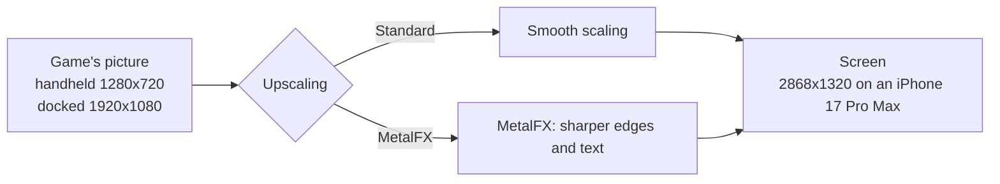
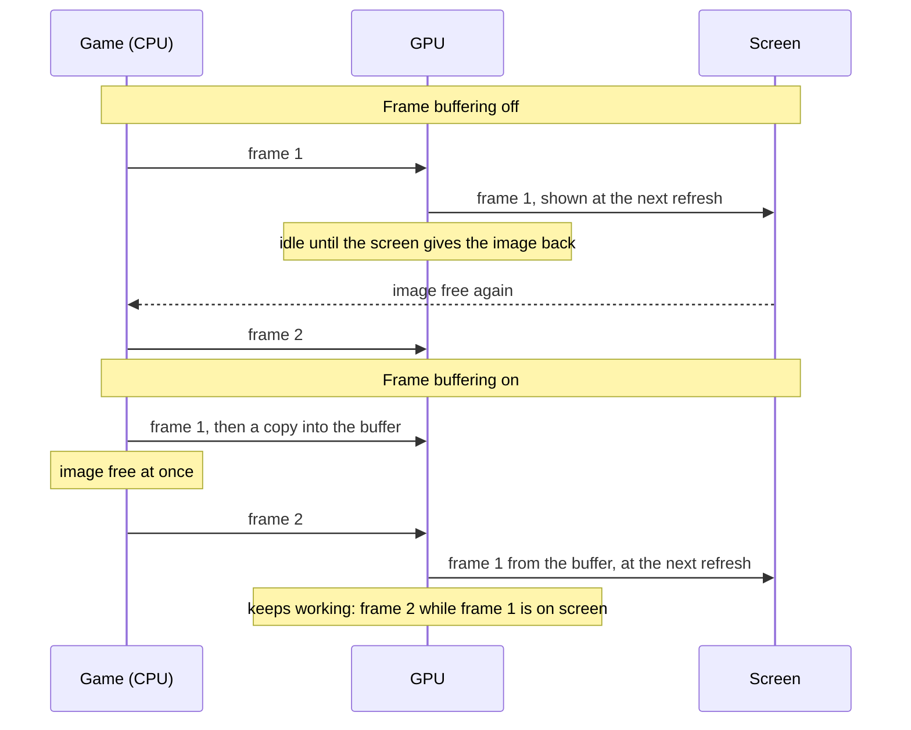
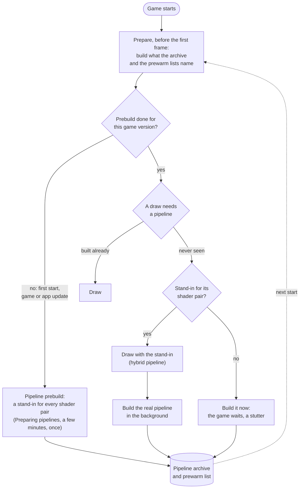
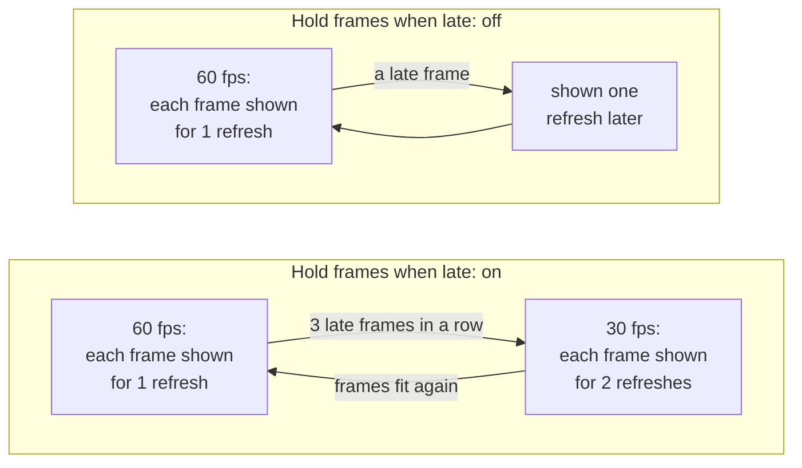

# Settings

The screen before the game starts shows the settings the game supports. A setting that only matters while another is on appears under it and disappears when that one is turned off. Tap **Play** to start; the app remembers your choices for the next start. Game, Controls and Performance settings share the home screen. BOTW has a **Touch settings** button that opens its layout and movement editor. **Upscaling** is in **Game**, beside **Console mode**. A Mac app shows the same settings in a [window of its own](#the-mac-settings-window).

- [Tested defaults](#tested-defaults)
- [Game](#game): [Frame rate](#frame-rate), [Render scale](#render-scale), [Console mode](#console-mode), [Upscaling](#upscaling), [Game language](#game-language), [Frame-rate counter](#frame-rate-counter)
- [Controls](#controls): [Touch feedback](#touch-feedback), [Game rumble](#game-rumble), [Rumble strength](#rumble-strength), [Rumble cutoff](#rumble-cutoff)
- [Touch left stick](#touch-left-stick): BOTW movement deadzone, response curve, full movement and size
- [Performance](#performance): [Experimental frame generation](#experimental-frame-generation), [Experimental low-memory mode](#experimental-low-memory-mode), [Frame buffering](#frame-buffering), [Metal 4 pipelines](#metal-4-pipelines), [Pipeline prebuild](#pipeline-prebuild), [Encode thread](#encode-thread), [Hold frames when late](#hold-frames-when-late), [Performance HUD](#performance-hud), [Reset to tested defaults](#reset-to-tested-defaults)
- [The Mac settings window](#the-mac-settings-window): [Display mode](#display-mode)
- [Settings in a file](#settings-in-a-file)

## Tested defaults

Each game comes with the settings it was tested with: its profile in this repository says, for example, that Breath of the Wild runs with Frame buffering and Metal 4 pipelines on, because that combination held a steady 60 fps on an iPhone 17 Pro Max. Those are the defaults the settings screen shows the first time.

When you change a setting and tap **Play**, the app keeps your choice, also when a later build of the app ships other defaults. A setting you leave at its default is not stored: it follows the defaults of the build you have, so a newer build's tested settings reach you without doing anything. BOTW's low-memory switch is the exception: manual On and Off are saved immediately, while an automatic choice is recalculated at launch. **Reset to tested defaults** at the bottom sets every setting back to its default, and **Play** then forgets your choices, so the game's defaults apply again. For testing, a line in `Documents/env.txt` overrides any setting ([Settings in a file](#settings-in-a-file)).

A Mac app carries the same list (`Contents/Resources/dm/launcher.json`), without the iPhone's own Frame-rate counter and Touch feedback, for a front end that starts the app with the chosen values ([Front ends](frontends.md)).

## Game

### Frame rate

Games whose speed the app controls (Breath of the Wild, Tears of the Kingdom and a few others) offer **30 fps** or **60 fps**. 60 is smoother; 30 is what the Switch ran and uses less power, so the phone stays cooler and the battery lasts longer. The game runs at real speed either way.

### Render scale

The size of the 3D picture, from 50 to 100 %. Below 100 % the size is fixed there and the game's own dynamic resolution is off; 100 % keeps the game's own. Lower can be lighter on the GPU but is blurrier; the HUD and text keep their sharpness. Only games the app can scale offer it.

### Console mode

**Docked** renders at the Switch's TV resolution, **Handheld** at its lower handheld resolution, which is lighter on the phone and can give a higher frame rate.

### Upscaling

A game that renders below the screen's resolution is scaled up to the screen. **Standard**, the default, scales smoothly; **MetalFX** uses Apple's MetalFX upscaler, which sharpens edges and text as it scales.

Breath of the Wild renders 1280x720 in handheld mode. Docked it renders its world at 900p and scales that to 1080p itself, before the app sees the picture. MetalFX works in either mode: handheld saves the most GPU time and heat, docked looks sharper than smooth scaling. Rendering at the screen's resolution stays the sharpest picture, where the GPU can afford it.

- **When to change it:** turn it on if the picture looks soft and the device has GPU time to spare: on a Mac, or on an iPhone in handheld mode at 30 fps. For long sessions at 60 fps on an iPhone leave it at Standard.
- **Cost:** more GPU time each frame, which can increase heat on an iPhone. [Breath of the Wild's measurements](../dm/games/01007EF00011E000/README.md#upscaling-current) cover Mac and iPhone; the matching iPhone Standard run and MetalFX's share of the thermal cost remain unmeasured. Nothing changes while the game's picture is as large as the screen. Unsupported devices and sizes use Standard scaling.
- **On the Mac:** choose **MetalFX** under **Upscaling** in the [settings window](#the-mac-settings-window)'s Advanced settings, or set `DM_PRESENT_UPSCALE=metalfx` in its `env.txt` (off by default). It helps in a large window or on a 4K screen.

### Game language

The game's own languages. The app was packed with one of them; pick another here without repacking.

### Frame-rate counter

Shows the frames per second at the top left.

## Controls

### Touch feedback

A light tap from the phone when you press an on-screen button.

### Game rumble

The game's vibration, on the phone or on a connected controller.

### Rumble strength

How strong the game's vibration is, from 0 to 300 %.

### Rumble cutoff

A controller's vibration weaker than this stays off, and the rest is spread over the full range. Off (0 %) by default. A controller with rotating motors can rumble all the time in a game that sends a quiet texture: Mario Kart 8 Deluxe needs about 45 % to rumble only on crashes and drifts. The phone's own vibration is not affected.

## Touch left stick

Breath of the Wild has a **Touch settings** button on the screen before **Play**. It opens a separate page with a layout preview and left-stick response controls. These settings apply only to BOTW touch mode; physical controllers and other games keep their existing behavior.

Select a control in the preview or the control picker. Drag it to move, pinch to resize, or use the offset and size sliders. XYAB moves and scales as one group, with a separate **Button spacing** slider. The D-pad and its equipment icons move and scale as one group. Left stick, shield stick, Rune (L), R and ZR adjust separately. **+** and **−** stay fixed. Offsets are fractions of the centered game UI canvas, so they adapt to different screen sizes.

**Restore this control** resets the selected group's position and size, including XYAB spacing when selected. **Restore all touch defaults** also resets the left-stick response. Both leave frame rate and graphics settings alone. **Corner button labels** shows or hides the small letter circles on L, R, ZR and XYAB; the icons and main button input remain available. R and ZR have the same base diameter, with their existing independent size controls.

| Setting | Default | Range | Effect |
|---|---|---|---|
| Deadzone | 7% | 0–30% | Small drags within this fraction of the radius produce no movement. |
| Response curve | 0.30 | 0.30–2.00 | Below 1 makes short drags stronger; 1 is linear; above 1 makes them gentler. |
| Full movement at | 71% | 35–100% | How far to drag, as a fraction of the radius, to reach maximum stick strength. |
| Stick size | 80% | 60–150% | Scales the whole stick: its center artwork, outer ring and drag range. |

**Current parameters** displays every touch value as a `DM_...=value` assignment. **Copy all parameters** copies that complete list, including unchanged defaults, so you can send a layout back to the developer without estimating positions from a screenshot. Offset and size readouts show the exact decimal as well as its percentage. These are the normalized runtime values used by the preview and both gamepads.

The BOTW launcher and touch editor follow the app's system language, with English and Simplified Chinese resources. Game language remains a separate setting.

The curve updates as you adjust the sliders. Drag across it to see the stick strength at each finger distance. Tap **Play** to save your choices for the next start. A value fixed by an env file stays fixed, including when restoring defaults.

Size at 100% keeps the existing dimensions: a 140-point outer diameter when the viewport is taller than 430 points, with the existing scaling on shorter screens. These settings do not add an overshoot sprint gesture; B keeps its ordinary action.

On the Mac, touch preview uses the same parameters through `DM_BOTW_MOVE_DEADZONE`, `DM_BOTW_MOVE_CURVE`, `DM_BOTW_MOVE_FULL` and `DM_BOTW_MOVE_SIZE` in `env.txt` or the launch environment. Fractions are written as decimals: for example, `DM_BOTW_MOVE_DEADZONE=0.07` means 7%. Packaged Mac apps expose the same Touch settings page; the raw host uses the launch environment. Layout variables use the prefix `DM_BOTW_PAD_` followed by `<CONTROL>_X`, `<CONTROL>_Y` or `<CONTROL>_SCALE`, where `<CONTROL>` is `FACE`, `DPAD`, `ZL`, `L`, `R` or `ZR`. Movement uses `DM_BOTW_PAD_STICK_X` / `_Y` and the existing `DM_BOTW_MOVE_SIZE`. `DM_BOTW_PAD_FACE_GAP` controls XYAB spacing (default `1.060`). Corner letter circles are off by default; `DM_BOTW_PAD_BADGES=1` enables them. The runtime and Restore defaults match the values listed in `dm/games/settings.tsv`; saved custom choices and explicit environment overrides retain precedence.

If a BOTW menu does not respond to direct touch on iPhone, **double-tap with three fingers** to reveal the original full virtual gamepad for that menu visit. It sends ordinary buttons and UI right-stick input. Leaving menus restores the normal touch layout; a controller connection or input reset also ends the temporary override. It is not saved. The gesture is reserved while automatic controls are hidden, so ordinary three-finger combat combinations keep working.

## Performance

These settings change how the app hands frames to the screen and how it prepares the GPU's work. The game's tested defaults are a good start; change them when a game stutters, runs hot, or you want less latency.

### Experimental frame generation

The Game Overlay home page offers **Experimental frame generation** as an off-by-default switch under **Performance**. It is shown only for a game profile with configured frame-generation inputs; currently only BOTW's Docked rendering path is adapted. Select **Docked** under Console mode to show it. The Mac launcher also puts this switch on its basic page.

On selects `DM_FRAMEGEN=30`: after the GPU passes the native capability check, the game runs up to 30 real frames per second, and MetalFX can insert a generated picture between pairs. Unsupported GPUs keep the original frame-rate setting. Off sets `DM_FRAMEGEN=0` and retains normal rendering and frame pacing. Play applies and remembers the choice. An environment override remains visible and locked, as for other settings. The current experiment has GPU cost and UI reconstruction limitations; [BOTW validation and remaining work](../dm/games/01007EF00011E000/README.md#experimental-metalfx-frame-generation).

### Experimental low-memory mode

BOTW only, on the experimental memory branch. With no saved manual choice, the launcher selects **on below 4.5 GiB of available memory** and **off at or above 4.5 GiB**. iPhone uses the current app's memory headroom (`os_proc_available_memory`), rather than installed RAM; Mac estimates reclaimable memory from free and inactive pages. If detection is unavailable, the default is off. Physical-iPhone validation of this threshold is still needed.

Manual **On or Off is remembered immediately**, including a choice equal to the automatic default, and takes priority on later launches. Automatic choices are not saved. **Reset to tested defaults**, followed by **Play**, clears the override and returns to automatic selection. Existing launch/environment-file overrides keep their usual priority. When enabled, a notice below **Play** explains that the mode helps keep the game running and may affect performance.

The mode uses file-backed guest memory, shorter-lived GPU upload sources and a smaller pipeline cache learned during play. The app chooses its own temporary folder; no paths or extra environment options are needed.

The preset disables whole-game pipeline prebuild and the bundled pipeline archive, so the **Pipeline prebuild** setting is hidden while it is on. Storage activity can increase, and a new scene may pause to compile pipelines. The existing full cache and saves are retained. To compare modes, close and relaunch the app, change the switch and use the same save and scene. It cannot change an already running game's heap.

With the switch off, the original heap, GPU pool handling and pipeline/cache settings remain in use. Older experiment environment flags cannot enable the memory changes on their own.

Mac measurements showed a reduction, but the iPhone result remains unverified. [Preset details, log checks and measurement limits](experiments/file-backed-memory.md#enable-from-the-game-overlay).

### Frame buffering

Each finished frame is copied into a buffer of two images that the screen shows from, so the game can start its next frame at once instead of waiting for the screen to give its image back.

Without it the GPU idles between frames, and iOS reads that idle time as room to spare: it lowers the GPU's clock, and the frames take longer still. On an iPhone 17 Pro Max, Breath of the Wild fell to 30 fps without frame buffering and held 60 with it.

- **When to change it:** turn it off if you notice the controls lag behind and the game holds its frame rate without it.
- **Cost:** up to one frame more latency between your input and the screen (about 28 ms more on an iPhone 17 Pro Max), and two more frame-sized images in memory.

### Metal 4 pipelines

Before the GPU can draw something, the app has to build a *pipeline* for it: the game's shaders compiled for the iPhone's GPU, with the drawing settings. Building one takes tens of milliseconds, so a scene full of new ones stutters. With Metal 4 pipelines the app keeps what it built in a pipeline archive on the phone, and builds most pipelines in a few microseconds from a shared base.

At start, before the game's first frame, the app prepares what it already knows: the pipelines in the archive and those the prewarm lists name (one comes with the game, one grows on the phone as you play); with a warm archive that takes well under a second. A pipeline never seen before is drawn meanwhile with a stand-in for its pair of shaders, a *hybrid* pipeline that reads the draw's vertices in a general way and draws the same picture, while the real pipeline is built in the background and archived for the next start.

- **When to change it:** turn it off only if a game crashes or runs out of memory with it.
- **Cost:** memory for the archive while the game runs, and storage on the phone.

### Pipeline prebuild

Builds a stand-in for every pair of shaders the game has (15,767 for Breath of the Wild) and puts them into the pipeline archive, so that a scene you have never seen has a stand-in for each of its draws instead of a stutter. It runs before the game's first frame, behind a **Preparing pipelines** screen: the first start waits a few minutes for it, once, and so does the first start after a game update or an app update that brings new shaders. Every other start skips it. It needs Metal 4 pipelines.

Built in the background while playing instead, the stand-ins took an iPhone 17 Pro Max's GPU from about 13 to 15–18 ms a frame in Breath of the Wild, so the app does the work up front.

- **When to change it:** turn it off if you don't want to wait at that first start.
- **Cost:** on, a wait of a few minutes once. Off, no wait, but a pipeline seen for the first time makes the game stall briefly while it is built, until the archive holds it.

### Encode thread

The app turns the game's graphics commands into Metal commands on a thread of its own instead of the game's submitting thread, so the game's thread can go on sooner (in Breath of the Wild about 4 ms per frame instead of 8). Frame buffering needs it for games that present their frames from another thread than the one that draws them. It is on by default on the iPhone; on the Mac it is off, where it lowered the typical frame time but made the slowest frames slower.

- **When to change it:** leave it on unless a game misbehaves with it; turning it off is a diagnostic step.

### Hold frames when late

For games whose frame rate the app controls ([Frame rate](#frame-rate)). With 60 fps chosen, each frame is meant to stay on screen for one refresh. When a frame comes late, the app can either slow the game down to 30 fps for a while, or keep 60 and show late frames as they come.

- **On** (the default for most games): an even 30 fps (or 20) in heavy scenes instead of a mix of 30 and 60.
- **Off:** the game keeps aiming at 60; a late frame is shown one refresh later and the next one goes on as usual, so heavy scenes look less even but stay closer to 60 on average.
- **When to change it:** turn it off if the game often falls to 30 fps although it is only slightly late.

### Performance HUD

Apple's performance overlay over the game: frame rate, frame and GPU times, memory. Useful to see what a setting changes; leave it off for play.

### Reset to tested defaults

Sets every setting back to the game's tested default; **Play** then forgets your choices, so those defaults apply, and those of later builds too ([Tested defaults](#tested-defaults)). Settings fixed by `Documents/env.txt` stay as the file says.

## The Mac settings window

A Mac app ([A Mac app](development.md#a-mac-app)) shows its settings in a window before the game starts. They are the same settings as on the iPhone, with the same defaults. The window shows the most used ones first: **Frame rate**, **Render scale**, **Console mode**, **Game language**, **Display mode** and **Game rumble**, when the game has them. **Render scale** shows the picture's size in pixels beside the percentage for the chosen **Console mode**, when the game's profile has it (Breath of the Wild: 1600 × 900 docked, 1280 × 720 handheld at 100 %). The others are under **Advanced settings**, in the usual sections, with **Reset to tested defaults**. The window remembers whether Advanced settings is open. **Frame-rate counter** and **Touch feedback** are only on the iPhone.

Click **Play** (or press Return) to start the game. **Quit**, ⌘Q or closing the window ends the app without the game. The app remembers your choices for that game, and a game started without the window, from a front end or with the window turned off, uses them too ([Saved choices](frontends.md#saved-choices)). A setting fixed by an `env.txt` or by the program that started the app is shown greyed out.

Turn off **Show this window at launch** to start the game at once with your choices. Hold Option while the app opens to see the window again. `DM_LAUNCHER=0` in the app's `env.txt` (`~/Library/Application Support/nxnative/<title ID>/env.txt`) or in its environment, or opening it with `open <app> --args --no-launcher`, also skips the window; your choices still apply. `DM_SAVED_CHOICES=0` starts with the tested defaults instead.

### Display mode

**Window** or **Fullscreen**: how the game's window opens. ⌃⌘F or the green button changes it while you play. In an `env.txt`: `DM_FULLSCREEN=1` or `0`.

### Cloud saves folder

**Choose a folder…** picks the iCloud Drive folder the game's save is synced through, the one the iPhone app chose in its launcher's **Cloud saves**, or the game's own folder inside it, named after its title ID ([Cloud saves](#cloud-saves)); **Turn off** stops it. Off by default. macOS may ask once whether the app may open iCloud Drive; if the game log says `this app may not open iCloud Drive`, allow it in System Settings › Privacy & Security › Files and Folders. In an `env.txt`: `DM_SAVE_SYNC=<folder>`, or `DM_SAVE_SYNC=icloud` for iCloud Drive › nxnative Saves; the window then shows it fixed.

## Cloud saves

The Mac app and the iPhone app of one game can share a save through iCloud Drive. Choose the same iCloud Drive folder on both: **Cloud saves** › **Choose a folder…** in the Mac settings window, and **Cloud saves** in the iPhone launcher (any folder, for instance one named **nxnative Saves**). Each game keeps one file there, `<title ID>/save.dmsync`, which holds the whole save.

When the game starts, it brings the save from iCloud Drive in if that one is the one to keep; a few seconds after the game saves, it sends its save. The iPhone app also sends when it goes to the background, and the Mac app once the game has quit. If you played on both without the save getting across in between, the newer save wins.

A save that is replaced, on the device or in iCloud Drive, is kept first, beside the save in a folder named after it with `-backups` (on the iPhone `save-backups` in the Files app, under the app's name; on the Mac `~/Library/Application Support/nxnative/<title ID>/save-backups`): `<date> local` holds this device's save, `<date> cloud` the one that was in iCloud Drive. The newest 10 of each kind stay, and older ones are removed; other folders you put there are left alone.

iCloud Drive takes a moment to carry a file from one device to the other. Quit the game on one device and give it a few seconds before you start it on the other. Without a connection the game plays on with the save it has and sends it later. The game log says what came in and what went out (lines starting with `save sync:`).

## Settings in a file

A line like `DM_PRESENT_SNAP=0` in `Documents/env.txt` (in the Files app, under the app's name) sets a setting from the file: the settings screen shows it greyed out, and the file wins over your choice and the game's default. Fully close and reopen the app after editing the file. The variables:

| Setting | Variable | Values |
|---|---|---|
| Frame rate | `DM_FPS_TARGET` | `30`, `60` |
| Render scale | `DM_RENDER_SCALE` | `0.5` to `1.0` |
| Console mode | `DM_OPMODE` | `1` docked, `0` handheld |
| Game language | `DM_LANG` | a language code, such as `ja` |
| Display mode (Mac) | `DM_FULLSCREEN` | `1` fullscreen, `0` a window |
| Cloud saves folder (Mac) | `DM_SAVE_SYNC` | a folder; `icloud`: iCloud Drive › nxnative Saves; `0`: off |
| Frame-rate counter | `DM_SHOW_FPS` | `1`, `0` |
| Touch feedback | `DM_TOUCH_HAPTICS` | `1`, `0` |
| Game rumble | `DM_RUMBLE` | `1`, `0` |
| Rumble strength | `DM_RUMBLE_GAIN` | `0` to `3` |
| Rumble cutoff | `DM_RUMBLE_MIN` | `0` to `0.9` |
| Upscaling | `DM_PRESENT_UPSCALE` | `off`, `metalfx` |
| Experimental frame generation | `DM_FRAMEGEN` | `30` on (30+30), `0` off |
| Experimental low-memory mode (BOTW) | `DM_LOW_MEMORY` | `1`, `0` |
| Frame buffering | `DM_PRESENT_SNAP` | `1`, `0` |
| Metal 4 pipelines | `DM_PSO_MTL4` | `1`, `0` |
| Pipeline prebuild | `DM_PSO_PREBUILD` | `1`, `0` |
| Encode thread | `DM_NVN_ENC_THREAD` | `1`, `0` |
| Hold frames when late | `DM_FPS_HOLD` | `on`, `off` |
| Performance HUD | `DM_METAL_HUD` | `1`, `0` |

`DM_LAUNCHER=0` skips the settings screen; the choices you saved there still apply. `DM_SAVED_CHOICES=0` starts with the tested defaults and keeps your saved choices for later. How the settings are listed for each game: [dm/games/settings.tsv](../dm/games/settings.tsv).
